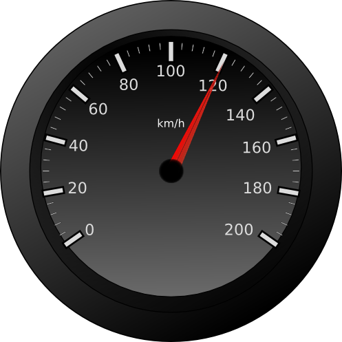
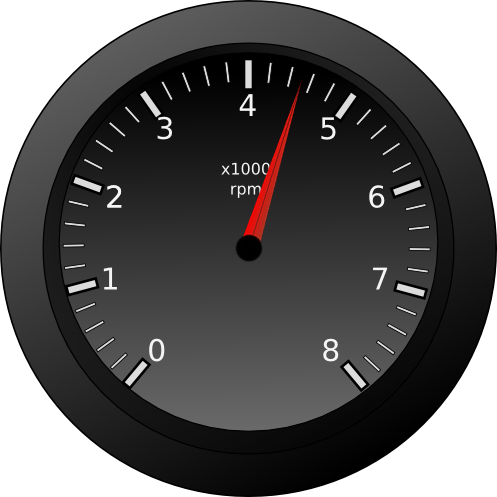

# Disseny de ginys en QML (Qt / QML · 2016)

[English](README.md) · **Català** · [Español](README.es.md)

Projecte final del cicle **DAM (Desenvolupament d'Aplicacions Multiplataforma), curs 2015-2016**.
El vaig desenvolupar el maig del 2016, en unes quatre setmanes, amb **Qt 5, QML / Qt Quick i C++**. El codi, els comentaris i la documentació estan en català, tal com es van lliurar.

<p align="center">
  
  
</p>

## Context

El projecte va començar com un **quadre de comandament digital** per a una empresa que fabricava cotxes personalitzats i volia renovar el seu tauler. Com que no tenia a mà el maquinari per simular el **bus CAN** del cotxe, vaig simular les dades amb dos **ESP8266**, cadascun amb un potenciòmetre, que enviaven la velocitat i les revolucions per **UDP** a una aplicació Qt. L'aplicació també es va provar en una **Raspberry Pi 3**.

Amb el velocímetre funcionant, vaig portar el projecte un pas més enllà. En aquell moment, dissenyar una interfície d'aquest estil amb Qt Creator era complicat, i feia falta una eina més senzilla. Inspirant-me en *CX-Supervisor* (un programari SCADA), vaig fer una **prova de concepte d'un IDE per dissenyar ginys en QML** sense haver de saber programar. Permet crear formes de manera dinàmica, editar-ne les propietats i carregar ginys ja fets, com el mateix velocímetre.

## Contingut

```
velocimetre/
  speedQT/          App Qt Quick: velocímetre + comptarevolucions animats
  esp8266/          Sketches d'Arduino per a ESP8266 (potenciòmetre → UDP)
  raspberry-pi/     .pro generat amb qmake i notes per a la Raspberry Pi 3
dissenyador-ginys/  "CX": IDE en Qt Widgets per dissenyar ginys QML
docs/               Memòria, manuals d'usuari, presentació i dissenys gràfics
```

### 1. Velocímetre (`velocimetre/`)

- **Frontend QML**: els components `Velocimeter.qml` i `Rpm.qml` mouen l'agulla girant una imatge, amb `Behavior` + `SpringAnimation` perquè el moviment sigui suau. En arrencar, els dos indicadors entren amb una rotació 3D (`Rotation` sobre l'eix Y). També es poden controlar amb el teclat.
- **Backend C++**: la classe `Actualitzador` obre un `QUdpSocket` al port 45455 i llegeix trames `km:<0-1023>` / `rpm:<0-1023>`. Converteix el valor de l'entrada analògica a 0-200 km/h i 0-8000 rpm i l'escriu al QML amb `setProperty()` sobre objectes localitzats per `objectName` amb `findChild()`.
- **Maquinari**: dos ESP8266 que cada 100 ms llegeixen l'entrada analògica `A0` i n'envien el valor per UDP.

### 2. Dissenyador de ginys QML (`dissenyador-ginys/`)

Aplicació d'escriptori en **Qt Widgets** (`QMainWindow`, formularis `.ui`, barra d'eines) que integra una escena QML amb `QQuickView` + `QWidget::createWindowContainer`.

- **Creació dinàmica d'objectes QML des de C++**: `Organitzador` crida funcions JavaScript de l'escena (`QMetaObject::invokeMethod`), i aquestes creen rectangles, cercles i textos en temps d'execució.
- **Edició de propietats**: cada element l'embolcalla un `Objecte` (C++), que en modifica el color, el radi, la mida i l'escala. Un diàleg (`informacio.ui`) mostra les dades de l'element seleccionat.
- **Interacció en QML**: arrossegar i deixar anar, punts per canviar la mida i una `DropArea` per deixar-hi fitxers.
- **Ginys externs**: es pot obrir un `.qml` del disc, per exemple `ControllerVel.qml` amb el velocímetre, i inserir-lo a l'escena.
- Comunicació C++ ↔ QML amb **signals/slots**, la sintaxi nova de `connect` amb punters a funció i models UML (`.qmodel`) fets amb Qt Creator.

## Tecnologies

Qt 5 · QML / Qt Quick 2 · C++ · Qt Widgets · QtNetwork (UDP) · qmake · Qt Creator · ESP8266 (Arduino) · Raspberry Pi 3

## Compilar

Està pensat per a **Qt 5** (2016) i s'obre des de Qt Creator amb el `.pro` de cada aplicació. Notes:

- El `speedQT.pro` d'escriptori no inclou `QT += network`, tot i que el backend fa servir `QUdpSocket`. El de `velocimetre/raspberry-pi/` sí que l'inclou.
- Als sketches de l'ESP8266, la SSID, la contrasenya i la IP de destí són buides i cal omplir-les.
- El codi és tal com es va lliurar el 2016, sense modernitzar.

## Documentació

- [Memòria del projecte (PDF)](docs/Memoria.pdf)
- [Manual d'usuari: velocímetre](docs/Manual_usuari-Velocimetre.pdf)
- [Manual d'usuari: dissenyador de ginys](docs/Manual_usuari-Ginys.pdf)
- [Presentació](docs/Presentacio.pdf)

Autor: **Francisco Mesas Cervilla**
