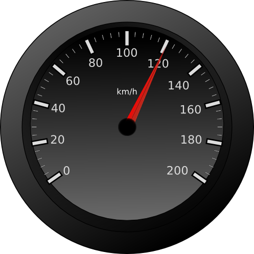
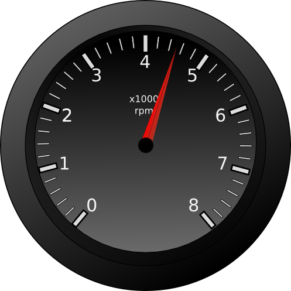

# Disseny de ginys en QML (Qt / QML · 2016)

[English](README.md) · [Català](README.ca.md) · **Español**

Proyecto final del ciclo **DAM (Desarrollo de Aplicaciones Multiplataforma), curso 2015-2016**.
Lo desarrollé en mayo de 2016 en unas cuatro semanas con **Qt 5, QML / Qt Quick y C++**. El código, los comentarios y la documentación están en catalán, como se entregó.

<p align="center">
  
  
</p>

## Contexto

El proyecto empezó como un **cuadro de mandos digital** para una empresa que fabricaba coches personalizados y quería renovar su salpicadero. Como no tenía a mano el hardware para simular el **bus CAN** del coche, simulé los datos con dos **ESP8266**, cada uno con un potenciómetro, que enviaban la velocidad y las revoluciones por **UDP** a una aplicación Qt. La aplicación también se probó en una **Raspberry Pi 3**.

Con el velocímetro funcionando, llevé el proyecto un paso más allá. En ese momento, diseñar una interfaz de este estilo con Qt Creator era complicado, y hacía falta una herramienta más sencilla. Inspirándome en *CX-Supervisor* (un software SCADA), hice una **prueba de concepto de un IDE para diseñar widgets (“ginys”) en QML** sin necesidad de saber programar. Con él se pueden crear formas de manera dinámica, editar sus propiedades y cargar widgets ya hechos, como el propio velocímetro.

## Contenido

```
velocimetre/
  speedQT/          App Qt Quick: velocímetro + cuentarrevoluciones animados
  esp8266/          Sketches de Arduino para ESP8266 (potenciómetro → UDP)
  raspberry-pi/     .pro generado con qmake y notas para la Raspberry Pi 3
dissenyador-ginys/  "CX": IDE en Qt Widgets para diseñar widgets QML
docs/               Memoria, manuales de usuario, presentación y diseños gráficos
```

### 1. Velocímetro (`velocimetre/`)

- **Frontend QML**: los componentes `Velocimeter.qml` y `Rpm.qml` mueven la aguja girando una imagen, con `Behavior` + `SpringAnimation` para que el movimiento sea suave. Al arrancar, los dos indicadores entran con una rotación 3D (`Rotation` sobre el eje Y). También se pueden controlar con el teclado.
- **Backend C++**: la clase `Actualitzador` abre un `QUdpSocket` en el puerto 45455 y lee tramas `km:<0-1023>` / `rpm:<0-1023>`. Convierte el valor de la entrada analógica a 0-200 km/h y 0-8000 rpm y lo escribe en el QML con `setProperty()` sobre objetos localizados mediante `objectName` y `findChild()`.
- **Hardware**: dos ESP8266 que cada 100 ms leen la entrada analógica `A0` y envían el valor por UDP.

### 2. Diseñador de widgets QML (`dissenyador-ginys/`)

Aplicación de escritorio en **Qt Widgets** (`QMainWindow`, formularios `.ui`, barra de herramientas) que integra una escena QML mediante `QQuickView` + `QWidget::createWindowContainer`.

- **Creación dinámica de objetos QML desde C++**: `Organitzador` llama a funciones JavaScript de la escena (`QMetaObject::invokeMethod`), y estas crean rectángulos, círculos y textos en tiempo de ejecución.
- **Edición de propiedades**: cada elemento lo envuelve un `Objecte` (C++), que modifica color, radio, tamaño y escala del objeto QML. Un diálogo (`informacio.ui`) muestra los datos del elemento seleccionado.
- **Interacción en QML**: arrastrar y soltar, puntos para cambiar el tamaño y una `DropArea` para soltar ficheros.
- **Widgets externos**: se puede abrir un `.qml` desde el disco, por ejemplo `ControllerVel.qml` con el velocímetro, e insertarlo en la escena.
- Comunicación C++ ↔ QML con **signals/slots**, la sintaxis nueva de `connect` con punteros a función y modelos UML (`.qmodel`) hechos con Qt Creator.

## Tecnologías

Qt 5 · QML / Qt Quick 2 · C++ · Qt Widgets · QtNetwork (UDP) · qmake · Qt Creator · ESP8266 (Arduino) · Raspberry Pi 3

## Compilar

Está pensado para **Qt 5** (2016) y se abre desde Qt Creator con el `.pro` de cada aplicación. Notas:

- El `speedQT.pro` de escritorio no incluye `QT += network`, aunque el backend usa `QUdpSocket`. El de `velocimetre/raspberry-pi/` sí lo lleva.
- En los sketches del ESP8266, la SSID, la contraseña y la IP de destino están vacías y hay que rellenarlas.
- El código está tal como se entregó en 2016, sin modernizar.

## Documentación

- [Memoria del proyecto (PDF, catalán)](docs/Memoria.pdf)
- [Manual de usuario: velocímetro](docs/Manual_usuari-Velocimetre.pdf)
- [Manual de usuario: diseñador de widgets](docs/Manual_usuari-Ginys.pdf)
- [Presentación](docs/Presentacio.pdf)

Autor: **Francisco Mesas Cervilla**
