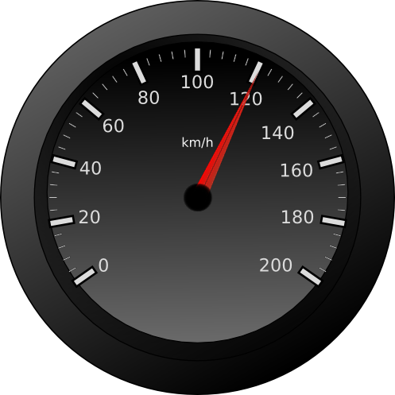
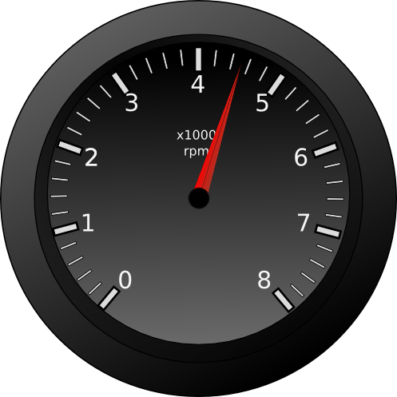

# QML Widget Designer (Qt / QML · 2016)

**English** · [Català](README.ca.md) · [Español](README.es.md)

Final project for my **DAM degree (Multiplatform Application Development, Spain), 2015-2016**.
I built it in May 2016, over about four weeks, with **Qt 5, QML / Qt Quick and C++**. The code, comments and documentation are in Catalan, exactly as they were submitted.

<p align="center">
  
  
</p>

## Background

The project started as a **digital instrument cluster** for a custom car manufacturer that wanted to upgrade its dashboard. I didn't have hardware to simulate the car's **CAN bus**, so I used two **ESP8266** boards instead. Each one had a potentiometer and sent speed or RPM readings over **UDP** to a Qt application. The application was also tested on a **Raspberry Pi 3**.

Once the speedometer worked, I took the project further. At the time, designing an interface like this with Qt Creator was complicated, and there was a need for something simpler. Inspired by *CX-Supervisor* (a SCADA tool), I built a **proof-of-concept IDE for designing QML widgets** that doesn't require any programming. It creates shapes at runtime, lets you edit their properties and loads ready-made widgets, such as the speedometer itself.

## Contents

```
velocimetre/
  speedQT/          Qt Quick app: animated speedometer + tachometer
  esp8266/          Arduino sketches for ESP8266 (potentiometer → UDP)
  raspberry-pi/     qmake-generated .pro and setup notes for Raspberry Pi 3
dissenyador-ginys/  "CX": Qt Widgets IDE for designing QML widgets
docs/               Project report, user manuals, slides and artwork (Catalan)
```

### 1. Speedometer (`velocimetre/`)

- **QML frontend**: the `Velocimeter.qml` and `Rpm.qml` components rotate a needle image, using `Behavior` + `SpringAnimation` for smooth movement. On startup both gauges flip in with a 3D `Rotation` around the Y axis. They can also be driven from the keyboard.
- **C++ backend**: the `Actualitzador` class opens a `QUdpSocket` on port 45455 and parses `km:<0-1023>` / `rpm:<0-1023>` frames. It scales the analog reading to 0-200 km/h and 0-8000 rpm, then writes the value into QML with `setProperty()`. The target objects are found by `objectName` with `findChild()`.
- **Hardware**: two ESP8266 boards read analog input `A0` every 100 ms and send the value over UDP.

### 2. QML widget designer (`dissenyador-ginys/`)

A **Qt Widgets** desktop app (`QMainWindow`, `.ui` forms, toolbar) that embeds a QML scene through `QQuickView` + `QWidget::createWindowContainer`.

- **Creating QML objects at runtime from C++**: `Organitzador` calls JavaScript functions in the scene with `QMetaObject::invokeMethod`, and those functions create rectangles, circles and text items.
- **Property editing**: each item is wrapped in a C++ `Objecte`, which changes the QML object's color, radius, size and scale. A dialog (`informacio.ui`) shows the selected item's details.
- **Interaction in QML**: drag and drop, resize handles, and a `DropArea` for dropped files.
- **External widgets**: you can open a `.qml` file from disk, for example `ControllerVel.qml` with the speedometer, and insert it into the scene.
- C++ ↔ QML communication through **signals/slots**, the function-pointer `connect` syntax, and UML models (`.qmodel`) made in Qt Creator.

## Tech stack

Qt 5 · QML / Qt Quick 2 · C++ · Qt Widgets · QtNetwork (UDP) · qmake · Qt Creator · ESP8266 (Arduino) · Raspberry Pi 3

## Building

It targets **Qt 5** (2016). Open each application's `.pro` file in Qt Creator. Notes:

- The desktop `speedQT.pro` is missing `QT += network`, even though the backend uses `QUdpSocket`. The one in `velocimetre/raspberry-pi/` includes it.
- In the ESP8266 sketches, the Wi-Fi SSID, password and target IP are left empty and must be filled in.
- The code is exactly as it was submitted in 2016. It has not been modernised.

## Documentation (Catalan)

- [Project report (PDF)](docs/Memoria.pdf)
- [User manual: speedometer](docs/Manual_usuari-Velocimetre.pdf)
- [User manual: widget designer](docs/Manual_usuari-Ginys.pdf)
- [Slides](docs/Presentacio.pdf)

Author: **Francisco Mesas Cervilla**
